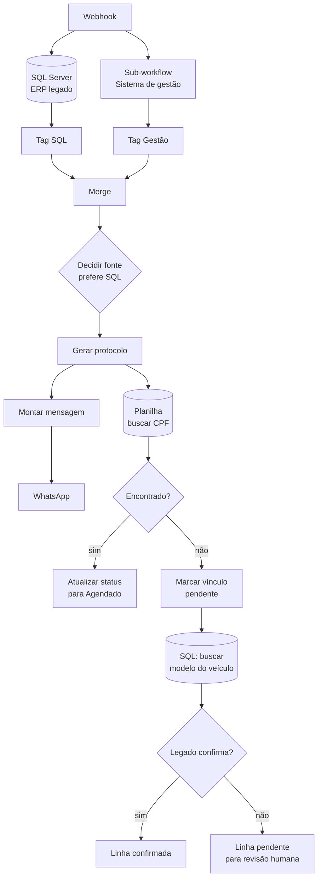

# n8n-painel-agendamento

Fluxo n8n que recebe um agendamento por webhook, procura o cliente em **duas
bases que não conversam entre si**, decide qual delas vale, gera protocolo,
avisa por WhatsApp e registra na planilha operacional.

32 nós.

## O problema

A empresa tinha o cliente em dois lugares: um ERP legado em SQL Server e um
sistema de gestão em nuvem. Cliente antigo estava no legado. Cliente novo
estava só na nuvem. Alguns estavam nos dois, com dado divergente.

Quando chegava um agendamento, ninguém sabia de antemão onde procurar — e
procurar na ordem errada devolvia dado velho.

## O caminho dos dados



## O back-end é híbrido, e é aí que mora a complexidade

Este fluxo não é "a automação por trás de um site". Ele é **parte de um back-end
dividido**, e entender isso é entender o problema real:

```
       ┌──────────────────────────────┐
       │   front-end escrito à mão    │
       │  (formulário de agendamento) │
       └───────┬──────────────┬───────┘
               │              │
        grava direto     dispara webhook
               │              │
               ▼              ▼
     ┌──────────────┐   ┌──────────────────┐
     │   BaaS       │   │   n8n            │
     │  (banco do   │   │  (este fluxo)    │
     │   formulário)│   │                  │
     └──────────────┘   └────────┬─────────┘
                                 │
                   ┌─────────────┼─────────────┐
                   ▼             ▼             ▼
             ERP legado    Sistema de    Planilha
             SQL Server     gestão       operacional
```

**Duas coisas respondem como back-end ao mesmo tempo.** O front-end grava o
agendamento direto no banco do BaaS — é o caminho rápido, e é o que o cliente
vê confirmado na tela. Em paralelo, dispara um webhook para o n8n, que faz o
trabalho pesado: cruzar o cliente nas bases de origem, decidir a fonte, gerar
protocolo, avisar por WhatsApp e atualizar a planilha que a operação usa.

**O custo disso é que os dois lados não compartilham estado.** O BaaS não sabe
se o n8n conseguiu casar o cliente; o n8n não escreve de volta no BaaS. Quando o
cruzamento falha, o cliente recebe a confirmação normalmente — mas a operação
não recebe o caso linkado. O sintoma é o pior possível: falha silenciosa, visível
só para quem olha a planilha.

É exatamente por isso que o nó de **vínculo pendente** existe, descrito abaixo.
Ele é a emenda que torna a falha visível, já que as duas metades do back-end não
conversam.

**Por que ficou assim.** O formulário precisava responder rápido e funcionar
mesmo com o n8n fora do ar; a lógica de cruzamento precisava de acesso ao ERP
legado, que o front não tem nem deve ter. Separar resolveu as duas coisas e
criou a terceira. A alternativa honesta — n8n como único back-end, com o front
só consumindo — custaria latência no formulário e um ponto único de falha na
hora da venda.

## Decisões que sustentam o fluxo

**Consulta as duas fontes em paralelo, não em cascata.** Perguntar primeiro a
uma e só depois a outra dobra o tempo de resposta do webhook no pior caso. As
duas saem juntas e o merge espera.

**Cada resultado é marcado com a origem antes do merge.** Depois de juntar, não
dá mais para saber de onde veio o registro. Os nós `Tag SQL` e `Tag Gestão`
carimbam a origem enquanto ela ainda é conhecida.

**A regra de desempate é explícita e tem nome.** O nó se chama
`Decidir Fonte (prefere SQL)` — a precedência fica escrita no canvas, não
escondida num `if` aninhado. Quem abrir daqui a um ano entende a regra sem ler
o código.

**"Não encontrado" não é erro, é um estado.** Quando o cliente não bate com
nenhuma das bases, o fluxo grava uma linha de **vínculo pendente** em vez de
falhar calado ou inventar correspondência. Alguém revisa depois.

Esse último ponto é o que mais importa. A tentação é tratar ausência de dado
como falha e abortar — e aí o agendamento some sem ninguém saber. Marcar como
pendente mantém o caso visível.

**Protocolo é gerado antes do disparo.** Se o envio do WhatsApp falhar, o
agendamento já existe e tem identificador. O contrário deixaria o cliente
avisado de algo que não foi registrado.

## O que foi retirado desta versão pública

- Nome da empresa, marcas e e-mails corporativos
- URL da instância n8n
- IDs de credencial e de webhook
- O sistema de gestão aparece como "SistemaGestao"

A arquitetura está intacta.

## Como usar

1. n8n → **Import from File** → `workflow.json`
2. Recrie as credenciais: SQL Server, Google Sheets e o provedor de WhatsApp
3. Troque o `webhookId` por um seu
4. Ajuste as queries SQL para o seu schema
5. O nó `Consultar Cliente` chama um sub-workflow — aponte para o seu

## Stack

n8n · SQL Server · Google Sheets · API REST · WhatsApp

## Licença

MIT
