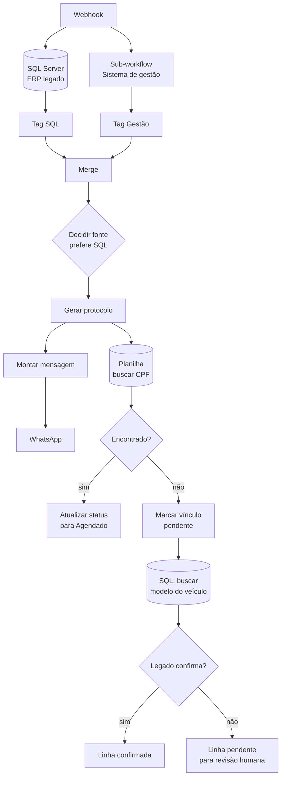

# n8n-painel-agendamento

Fluxo n8n que recebe um agendamento por webhook, procura o cliente em **duas
bases que não conversam entre si**, decide qual delas vale, gera protocolo,
avisa por WhatsApp e registra na planilha operacional.

32 nós.

## O problema

A empresa tinha o cliente em dois lugares: um ERP legado em SQL Server e um
sistema de gestão em nuvem. Cliente antigo estava no legado. Cliente novo
estava só na nuvem. Alguns estavam nos dois, com dado divergente.

Quando chegava um agendamento, ninguém sabia de antemão onde procurar — e
procurar na ordem errada devolvia dado velho.

## O caminho dos dados

## Decisões que sustentam o fluxo

**Consulta as duas fontes em paralelo, não em cascata.** Perguntar primeiro a
uma e só depois a outra dobra o tempo de resposta do webhook no pior caso. As
duas saem juntas e o merge espera.

**Cada resultado é marcado com a origem antes do merge.** Depois de juntar, não
dá mais para saber de onde veio o registro. Os nós `Tag SQL` e `Tag Gestão`
carimbam a origem enquanto ela ainda é conhecida.

**A regra de desempate é explícita e tem nome.** O nó se chama
`Decidir Fonte (prefere SQL)` — a precedência fica escrita no canvas, não
escondida num `if` aninhado. Quem abrir daqui a um ano entende a regra sem ler
o código.

**"Não encontrado" não é erro, é um estado.** Quando o cliente não bate com
nenhuma das bases, o fluxo grava uma linha de **vínculo pendente** em vez de
falhar calado ou inventar correspondência. Alguém revisa depois.

Esse último ponto é o que mais importa. A tentação é tratar ausência de dado
como falha e abortar — e aí o agendamento some sem ninguém saber. Marcar como
pendente mantém o caso visível.

**Protocolo é gerado antes do disparo.** Se o envio do WhatsApp falhar, o
agendamento já existe e tem identificador. O contrário deixaria o cliente
avisado de algo que não foi registrado.

## O que foi retirado desta versão pública

- Nome da empresa, marcas e e-mails corporativos
- URL da instância n8n
- IDs de credencial e de webhook
- O sistema de gestão aparece como "SistemaGestao"

A arquitetura está intacta.

## Como usar

1. n8n → **Import from File** → `workflow.json`
2. Recrie as credenciais: SQL Server, Google Sheets e o provedor de WhatsApp
3. Troque o `webhookId` por um seu
4. Ajuste as queries SQL para o seu schema
5. O nó `Consultar Cliente` chama um sub-workflow — aponte para o seu

## Stack

n8n · SQL Server · Google Sheets · API REST · WhatsApp

## Licença

MIT
